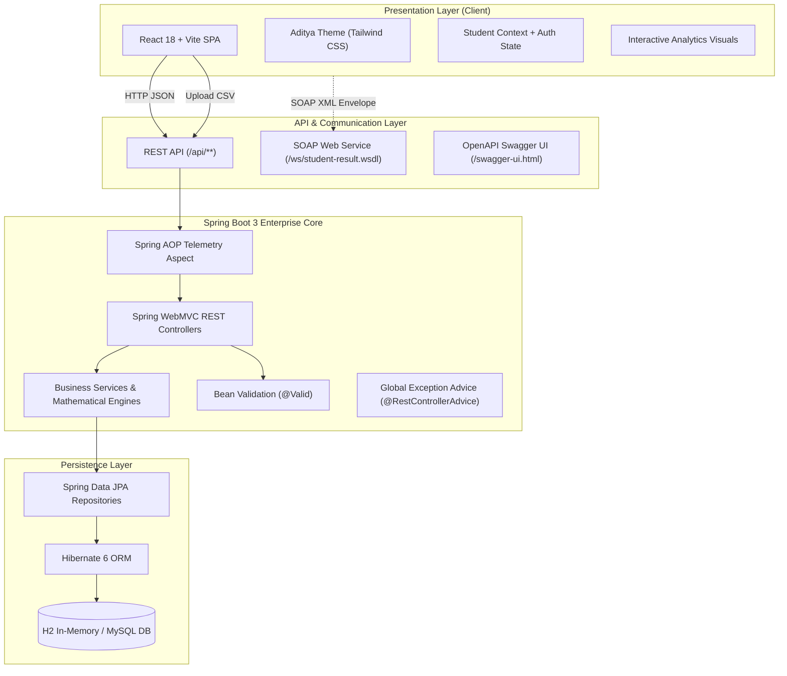

# SSIS SYSTEM ARCHITECTURE & DESIGN PATTERNS

---

## 1. High-Level Architecture Overview

---

## 2. Software Design Patterns Implemented

### 2.1. Model-View-Controller (MVC) & Layered Architecture
- **Controller Layer (`com.aditya.ssis.controller`):** Handles HTTP request mapping, parameter parsing, Bean validation (`@Valid`), and response construction with `ResponseEntity`.
- **Service Layer (`com.aditya.ssis.service`):** Contains business workflows, attendance calculus formulas, simulation engines, and transaction boundaries (`@Transactional`).
- **Data Access Layer (`com.aditya.ssis.repository`):** Spring Data JPA repositories with derived and custom JPQL queries.

### 2.2. Aspect-Oriented Programming (AOP) Pattern
- **Aspect:** `StudentLoggingAspect` intercepts all controller and service calls using `@Around("applicationPackagePointcut()")`.
- **Telemetry:** Measures execution latency in milliseconds, captures client IP, and asynchronously persists records into the `activity_logs` table.

### 2.3. Data Transfer Object (DTO) Pattern
Decouples persistent JPA entities from external API contracts, preventing over-fetching and protecting sensitive entity attributes:
- `AttendanceSummaryDto`
- `SubjectAttendanceDto`
- `ProjectionResponseDto`
- `PredictionResponseDto`
- `StudentReportDto`

### 2.4. Contract-First SOAP Service Pattern
- Defined XML Schema Definition (`student-result.xsd`).
- Spring WS automatically generates WSDL 1.1 at runtime (`/ws/student-result.wsdl`).
- Endpoint handles XML payload using DOM parsing without external JAXB code-gen friction.

### 2.5. Dual-Mode Client Fallback (Facade Pattern)
The frontend API service (`frontend/src/services/api.ts`) implements a robust fail-soft pattern:
- Attempts live calls to Spring Boot REST endpoints on `http://localhost:8080/api`.
- If the backend is offline or starting up, transparently serves local state from cached seed data, ensuring zero UI downtime during demonstrations.
